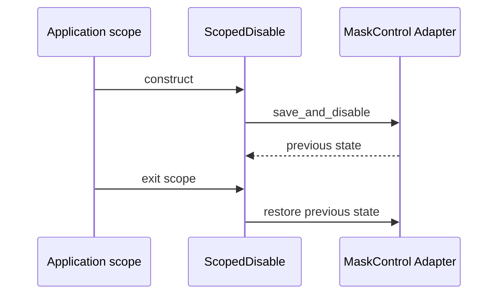

# Use the Interrupt Control Core

Public entry headers are [interrupt/interrupt.hpp](../include/interrupt/interrupt.hpp), [interrupt/scoped_disable.hpp](../include/interrupt/scoped_disable.hpp).

## Choose direct control or a scope guard

Bind `Interrupts` to a live `Controller&` to explicitly inspect, enable or disable its gate. To preserve the incoming state through a block of code, construct `ScopedDisable` directly with a live `MaskControl&`. Its constructor saves and masks atomically. Its destructor restores the saved state, including a previously disabled gate.

Nested guards restore in reverse order. Keep the guard in the same execution context and keep its Adapter alive through destruction. The guard cannot be copied or moved. Coordinate any explicit gate changes made while a guard is active.

## Composition and lifetime

Application code calls the Interrupt Control Core. It borrows the matching Contract, which an Adapter implements using its Hardware Definitions. Future Devices will create or bind these objects and establish their lifetime. To use the examples today, construct the facade directly with the supplied fake. Keep each borrowed resource alive for its use by the facade and follow the Adapter's access and synchronization requirements.

The sequence below shows state transfer across one lexical scope.

